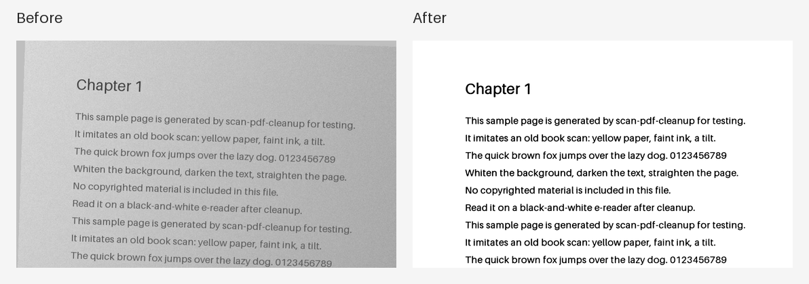

# 书签工具 – 扫描PDF清晰化

[한국어](README.md) · [English](README.en.md) · [日本語](README.ja.md)

把发黄、模糊的扫描PDF处理成白底黑字，在黑白电子书阅读器上也能清楚阅读。无服务器（仅检查新版本例外，可关闭），无需安装，绝不修改原文件。



## 下载

- **可执行文件**：在 [Releases](https://github.com/microhan1/scan-pdf-cleanup/releases) 下载 `scan-pdf-cleanup.exe`，双击即可运行，无需安装。
- **从源码运行**：

```bash
pip install -r requirements.txt
python main.py
```

## 使用方法

1. 把PDF文件或文件夹拖到窗口中。
2. 看着预览调整选项（背景变白 · 文字加深 · 色彩模式 · 倾斜校正 · 分辨率）。
3. 点击**开始**，在原文件旁生成 `<原名>_clean.pdf`。

也可以在命令行使用：

```bash
python main.py input.pdf --contrast mid --mode gray --dpi 200 --deskew
```

`python main.py --help` 会按操作系统语言（한국어 · English · 中文 · 日本語）显示选项。

## 不做的事

- 不做OCR，输出是图片PDF。
- 裁边、分页是另外的工具，本工具只处理画质。
- 以彩色照片为主的杂志扫描不在范围内。
- 不会自动下载或替换新版本。

## 检查新版本

启动时只把工具名称和版本发送到书签服务器（chaekgalpi.co.kr），用来确认是否有新版本。不发送任何文件，每天只检查一次，并且可以在设置中关闭。

有新版本时，会在窗口下方显示一行提示。点击**更新**会打开书签工具页面，程序不会自行下载或替换。

## 系列

- 书签工具：[裁边 (TrimPDF)](https://github.com/microhan1/TrimPDF) · [分页 (spread-split)](https://github.com/microhan1/spread-split) · [目录书签 (pdf-toc-add)](https://github.com/microhan1/pdf-toc-add)
- [书签图书馆（Chaekgalpi Library）](https://chaekgalpi.co.kr/tools/scanpdfcleanup?utm_source=github&utm_medium=referral&utm_campaign=tool_cta&utm_content=scanpdfcleanup) — 记录读过的书和读书笔记的网页服务（仅韩语）

## 许可证

源代码采用 MIT 许可，见 [LICENSE](LICENSE)。

Releases 中的 exe 包含 [PyMuPDF](https://github.com/pymupdf/PyMuPDF)（AGPL-3.0），因此 exe 整体按 AGPL-3.0 条款分发。对应源代码为本仓库及 PyMuPDF 仓库。 exe 所含组件及其许可证全文见 [THIRD_PARTY_LICENSES.txt](THIRD_PARTY_LICENSES.txt)。
